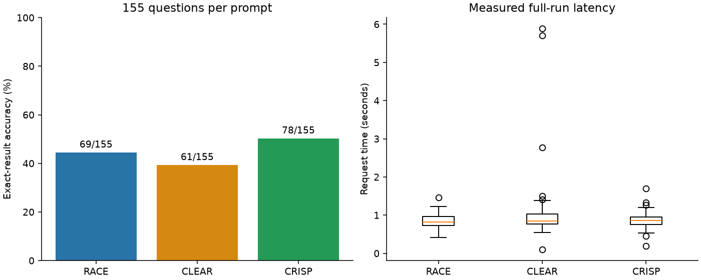

# Task 2 - Restaurant text-to-SQL

All 155 questions were run with each final prompt: **465 real predictions**.
The model was **qwen2.5:3b-instruct**, Q4_K_M, running on GPU through local
Ollama 0.40.3. Settings were temperature 0, seed 42, context 4096,
maximum output 512 tokens and repeat penalty 1.0, with streaming disabled.
Each request contained only one prompt and question, with no conversation
history or reference results. Framework order within questions was shuffled
with seed 20261014.

## Results

| Prompt | Correct / 155 | Accuracy | Mean time (s) | Median time (s) | SQL errors |
| --- | --- | --- | --- | --- | --- |
| RACE | 69/155 | 44.52% | 0.846 | 0.817 | 2 |
| CLEAR | 61/155 | 39.35% | 0.960 | 0.844 | 13 |
| CRISP | 78/155 | 50.32% | 0.858 | 0.855 | 3 |

CRISP had the highest accuracy; RACE had the shortest mean and median time.
CLEAR produced the most SQL errors. Accuracy uses the supplied evaluator's
exact row-multiset comparison: row order is ignored, but duplicate counts and
column order matter. The required columns are HOUSE_NUMBER and NAME.
Our [analysis script](../Task_4/analyze.py) imports the unchanged evaluator's
loader and comparison and scores SQL execution failures as incorrect.

Times are actual `perf_counter()` wall times around complete HTTP requests,
including local overhead, prompt processing and generation. The model was
already warm. There were no HTTP failures or retries. All raw outputs are
preserved, including three SQL-only formatting failures and two CLEAR responses
that reached the output-token cap (Q92 and Q96). SQL was not semantically repaired.

## Submitted data

`results/predictions_race.csv`, `predictions_clear.csv` and
`predictions_crisp.csv` contain outputs, model/prompt identifiers, per-request
wall times and Ollama duration/token metadata. A blank `raw_model_output`
means it equals `predicted_sql`. Shared settings, prompt hashes and environment
information are in [metadata.json](results/metadata.json). Offline scores are
in [per_question.csv](results/per_question.csv) and [summary.csv](results/summary.csv).

The dataset, schema and database are unchanged. Its 43 empty references can
reward incorrect filters; Q66 is unrelated to restaurants but has restaurant
labels. All questions remain included. [Task 4](../Task_4/report.md) discusses
these limitations and statistical significance. Reproduction commands are in
the repository README.
