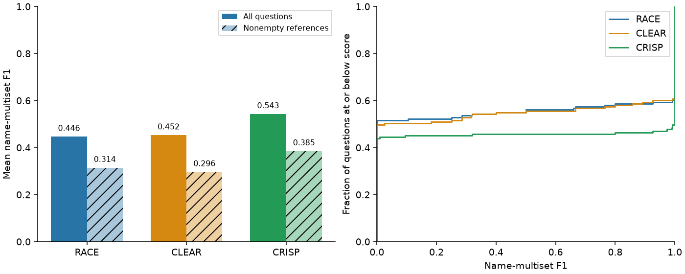

# Task 3 - Name-multiset F1

I propose name-multiset F1 to complement exact execution accuracy. Let P and G
be the multisets of restaurant names in column 2 of predicted and reference
HOUSE_NUMBER/NAME results:

`F1 = 2 * sum(min(P[name], G[name])) / (|P| + |G|)`.

This gives partial credit for retrieving some correct restaurants while
penalising missing and extra names. Returning one of two expected rows scores
2/3, whereas exact accuracy is zero. Duplicate counts matter; row order and
house numbers do not. Both results must have two columns. Failed execution or
wrong column count scores 0; two empty results score 1 and one empty result 0.

The implementation is [metric.py](metric.py). Labels are used only in offline
evaluation. Per-question scores and shared summaries are in
[Task 2 results](../Task_2/results/per_question.csv) and
[summary.csv](../Task_2/results/summary.csv).

| Prompt | Mean F1 | Nonempty mean F1 | Partial matches |
| --- | --- | --- | --- |
| RACE | 0.4463 | 0.3140 | 13 |
| CLEAR | 0.4524 | 0.2958 | 17 |
| CRISP | 0.5426 | 0.3848 | 9 |

CRISP has the highest mean F1. CLEAR slightly exceeds RACE on all questions,
although RACE has higher exact accuracy. Task 4 explains the projection errors
behind this difference.

F1 complements rather than replaces exact accuracy: it measures name retrieval
quality but ignores house-number errors and cannot distinguish branches sharing
a name beyond their multiplicities. Empty matches can hide incorrect filters,
and neither metric proves correctness on another database. I macro-average
across questions so large result sets do not dominate, and report the 112
nonempty-reference questions separately. No reference SQL is required.
