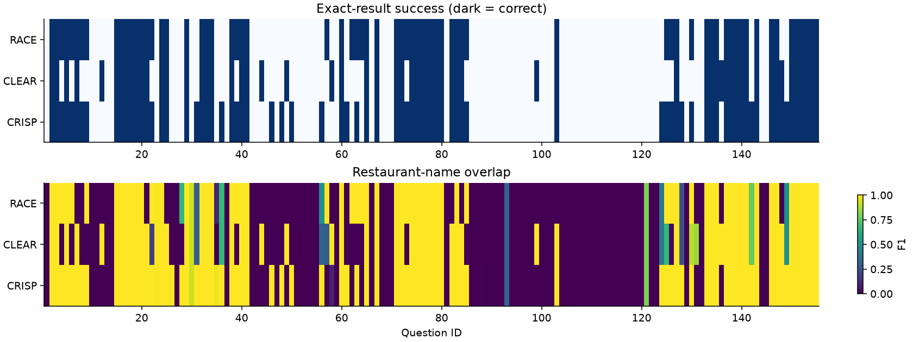
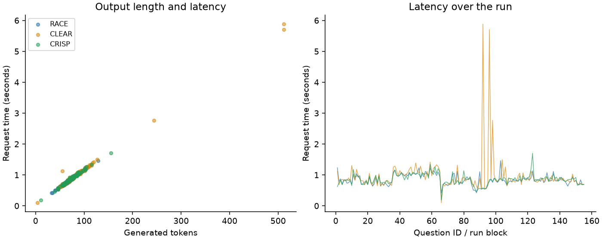

# Task 4 - Prompt comparison and statistics

The comparison uses the same 155 questions and local qwen2.5:3b-instruct
model for all three prompts. Their schema, task information, output rules and
original demonstration are equivalent; section organisation differs. Every
request has a fresh context and identical generation settings.

## Performance

| Prompt | Correct / 155 | Accuracy | Mean time (s) | Median time (s) | SQL errors |
| --- | --- | --- | --- | --- | --- |
| RACE | 69/155 | 44.52% | 0.846 | 0.817 | 2 |
| CLEAR | 61/155 | 39.35% | 0.960 | 0.844 | 13 |
| CRISP | 78/155 | 50.32% | 0.858 | 0.855 | 3 |

| Prompt | Mean F1 | Nonempty mean F1 | Partial matches |
| --- | --- | --- | --- |
| RACE | 0.4463 | 0.3140 | 13 |
| CLEAR | 0.4524 | 0.2958 | 17 |
| CRISP | 0.5426 | 0.3848 | 9 |

CRISP has the highest observed accuracy and F1. Compared with CLEAR, its
accuracy is 10.97 percentage points higher and mean F1 is 0.0901 higher;
compared with RACE, mean F1 is 0.0963 higher. RACE has the shortest median
request time. CLEAR's mean is 0.1145 s longer than RACE's, while medians
are closer.

## Statistical significance

Questions are the paired units. Accuracy uses Cochran's Q overall and exact
McNemar tests between pairs. F1 and latency use Friedman ranks overall and
two-sided exact sign tests between pairs. Sign tests measure which prompt
wins more often, not equality of means, and do not require symmetric differences.

All overall p-values use 49,999 within-question framework-label permutations,
with `(extreme + 1) / 50000` and seeds 42 (accuracy), 43 (F1) and 44 (latency).
This avoids relying on the Friedman asymptotic approximation with only three
treatments. Holm correction is applied separately to the three overall tests
and all nine planned pairwise tests; alpha is 0.05.

| Metric | Statistic | Permutation p | Holm p (3 tests) |
| --- | --- | --- | --- |
| accuracy | 13.1515 | 0.0013 | 0.0026 |
| f1 | 17.5766 | 0.00018 | 0.00054 |
| latency | 8.2194 | 0.01684 | 0.01684 |

| Metric | Pair (A / B) | A higher / B higher / ties | Raw p | Holm p (9 tests) |
| --- | --- | --- | --- | --- |
| accuracy | RACE / CLEAR | 15 / 7 / 133 | 0.1338 | 0.4014 |
| accuracy | RACE / CRISP | 3 / 12 / 140 | 0.035156 | 0.17578 |
| accuracy | CLEAR / CRISP | 6 / 23 / 126 | 0.0023157 | 0.01621 |
| f1 | RACE / CLEAR | 17 / 14 / 124 | 0.7201 | 1 |
| f1 | RACE / CRISP | 3 / 24 / 128 | 4.9233e-05 | 0.0004431 |
| f1 | CLEAR / CRISP | 8 / 27 / 120 | 0.0018782 | 0.015026 |
| latency | RACE / CLEAR | 64 / 91 / 0 | 0.036423 | 0.17578 |
| latency | RACE / CRISP | 62 / 93 / 0 | 0.015694 | 0.094162 |
| latency | CLEAR / CRISP | 81 / 74 / 0 | 0.63 | 1 |

For latency, "higher" means slower. All three overall differences are
significant after correction. Pairwise accuracy supports CRISP over CLEAR;
F1 supports CRISP over both RACE and CLEAR. No latency pair survives the
nine-test correction. The CRISP/RACE accuracy difference is also not significant
after correction. Nonsignificance does not establish equivalence.

## Interpretation: prompt, model and coding agent

RACE sometimes returns only NAME: 15 outputs have the wrong column count,
compared with CLEAR's 1 and CRISP's 0. Seven empty RACE outputs with this
mistake pass exact row comparison because both row sets are empty, but the
F1 metric rejects their projection. This explains the different RACE/CLEAR
rankings. CLEAR has 13 SQL errors and two capped responses. Its longer outputs
average 81.0 tokens, versus 71.0 for RACE and 72.1 for CRISP, contributing to
its higher mean latency.

The small quantized model also confuses city/street/county fields, invents
columns, misinterprets rating boundaries and sometimes uses LIMIT 1 instead of
returning all maximum-rating matches. These outputs remain unchanged.

RACE places the role/task before the schema and constraints last; CLEAR spreads
rules across five sections; CRISP starts with the schema. Ordering may affect
attention, but this single run cannot isolate general properties of these
frameworks from the particular templates or the model.

The coding agent supplied shared output conventions, the original example,
runner and offline error handling. These choices affect every variant. Prompts
were fixed before the final run; reference rows were never included in model
requests, and generated SQL was not repaired using labels. Temperature zero
reduces sampling variation but does not guarantee identical GPU results across
software versions.

Timing includes prefill, generation, cache effects and HTTP overhead. Shuffled
framework order spreads run-position effects. These measurements are from one
computer and one call per condition, so they are not repeated hardware benchmarks.

## Dataset limitations

| Prompt | Nonempty correct | Nonempty accuracy | Empty correct |
| --- | --- | --- | --- |
| RACE | 28/112 | 25.00% | 41/43 |
| CLEAR | 24/112 | 21.43% | 37/43 |
| CRISP | 37/112 | 33.04% | 41/43 |

The 43 empty references can reward incorrect filters; name F1 shares that
limitation. Nonempty accuracy is substantially lower. Q66 is unrelated to
restaurants but has nonempty labels; it remains in the denominator. Repeated
templates and paraphrases mean question blocks may be dependent, making nominal
p-values optimistic. Conclusions are exploratory and conditional on this
benchmark and model. Execution agreement on one database does not establish
semantic SQL equivalence on other data.

## Implementation and sources

[analyze.py](analyze.py) reproduces the saved scores, statistics and four report
figures without model calls; [paired_statistics.py](paired_statistics.py)
implements the tests. Full precision results and paired effect sizes are in
[statistics.json](results/statistics.json). Reproduction commands are in the README.

Methods: [Cochran Q](https://www.statsmodels.org/stable/generated/statsmodels.stats.contingency_tables.cochrans_q.html),
[McNemar](https://www.statsmodels.org/stable/generated/statsmodels.stats.contingency_tables.mcnemar.html),
[Friedman](https://docs.scipy.org/doc/scipy/reference/generated/scipy.stats.friedmanchisquare.html)
and [exact binomial sign test](https://docs.scipy.org/doc/scipy/reference/generated/scipy.stats.binomtest.html).
